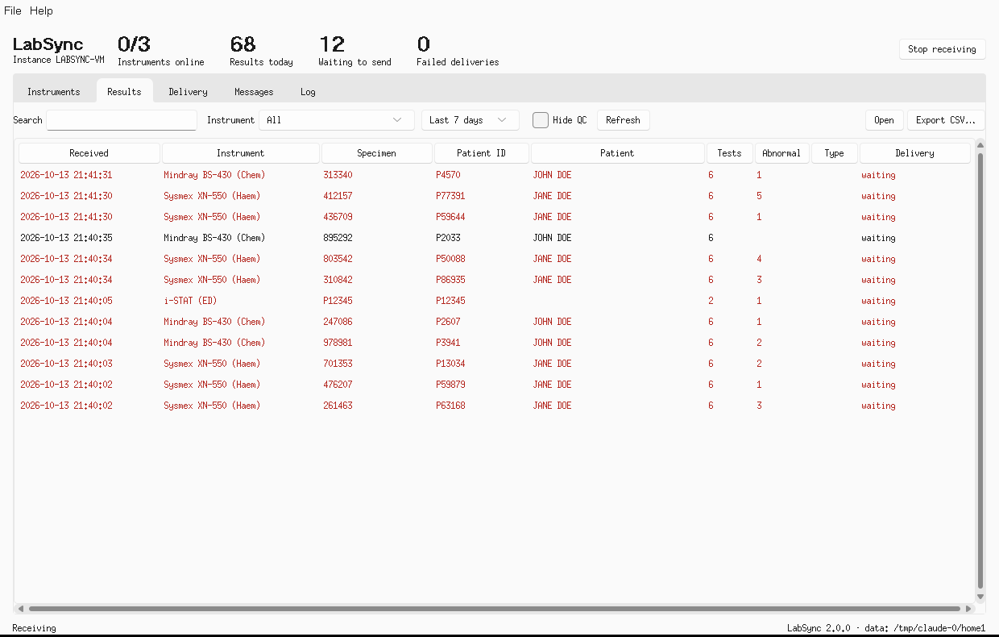

# LabSync

LabSync connects laboratory analyzers to the systems that need their results.
It listens to instruments over TCP/IP or RS-232, speaks their protocols
(ASTM, HL7, POCT1-A and a few vendor formats), stores every transmission
locally, and delivers results to your LIS, EMR or API with retries until the
receiver confirms them.

It runs as a desktop app on Windows and macOS (and headless on any OS).



## What it does

- **Instruments**: one connection per analyzer, as a TCP server (analyzer connects in), a TCP client
  (LabSync dials the analyzer) or a serial port. Each connection gets its own protocol session.
- **Protocols**
  - ASTM E1381 / LIS01-A2 link layer with checksums, ETB continuation frames, frame-number checks,
    NAK/retransmit, timeouts and line contention, plus E1394 / LIS2-A2 records (H, P, O, R, C, Q, M, L).
  - HL7 v2.x over MLLP: ORU^R01, OUL^R22, ACKs, encapsulated images (histograms, scattergrams), and
    host queries (Mindray QRY^Q02 -> QCK^Q02 + DSR^Q03).
  - POCT1-A2 XML device conversations (HEL, DST, OBS, EOT, ACK, REQ, END) for point-of-care managers.
  - Beckman Coulter AU online format and Siemens Dimension host interface (experimental).
  - Generic text capture with regular-expression extraction for anything else.
- **Host queries / worklists**: when an analyzer asks for a sample's orders, LabSync looks them up from your
  order service and answers in the analyzer's protocol.
- **Delivery** to any number of destinations, each with its own schedule (real time, every N minutes, or cron)
  and filters (which instruments, QC included or not):
  - HTTP/REST with JSON (LabSync schema, or the 1.x payload for existing integrations), API key, bearer,
    basic or OAuth2 client-credentials authentication.
  - FHIR R4 (transaction Bundle of Patient, Specimen, Observation and DiagnosticReport).
  - HL7 ORU^R01 to an LIS over MLLP.
  - A folder (JSON, CSV, HL7 or FHIR files) for systems that poll a share.
- **Reliable by design**: every message is written to a local SQLite database before it is acknowledged
  onward. A transactional outbox retries with exponential backoff, survives restarts and network outages,
  and parks permanently rejected items for review and one-click resend.
- **Secure defaults**: TLS is verified against the operating system's trust store (hospital CAs work),
  credentials live in the OS credential store (Windows Credential Manager / macOS Keychain), the config file
  is private to the user, XML is parsed with entity expansion disabled, and analyzers can be restricted to
  an IP allow-list.
- **Operations**: live instrument status, results browser with search, delivery queue with retry, raw message
  viewer (text and hex), rolling logs, single-instance guard, tray icon on Windows, auto-start, and a
  checksum-verified updater.

See [docs/DEVICES.md](docs/DEVICES.md) for the instrument catalog (about 50 profiles across Sysmex, Mindray,
Roche, Abbott, Siemens, Beckman Coulter, QuidelOrtho, HORIBA, Snibe, Bio-Rad, Tosoh, Stago, Werfen,
Radiometer, Nova, Cepheid, HUMAN, DiaSys and Erba) and how to commission a new one.

## Install

Download the latest release from the [Releases page](https://github.com/harrisyn/LabAnalyzer/releases):

- **Windows 10/11**: `LabSync-Setup-<version>.exe`. The installer can add a firewall rule for analyzers on
  the local network and start LabSync at sign-in. It upgrades 1.x installs in place.
- **macOS 11+ (Apple silicon)**: `LabSync-<version>.dmg`, drag LabSync to Applications.

Each release carries a `SHA256SUMS` file; the built-in updater refuses downloads that do not match it.

### From source

```bash
python -m venv .venv && . .venv/bin/activate      # Windows: .venv\Scripts\activate
pip install -e ".[dev]"
labsync                    # GUI
labsync-cli --headless     # service mode, logs to the data folder
```

Python 3.11+ with Tk is required for the GUI.

## Using it

1. **Instruments -> Add**: pick the analyzer model, choose how it connects, and note the port.
2. Configure the analyzer's LIS/host interface to send to this PC's IP and that port.
3. **Destinations -> Add**: choose REST, FHIR, HL7 or folder, enter the URL and credentials, press **Test**.
4. Results appear on the **Results** tab as they arrive; **Delivery** shows what is queued, sent or failed.

### Data folder

| OS | Location |
|---|---|
| Windows | `%LOCALAPPDATA%\LabSync` |
| macOS | `~/Library/Application Support/LabSync` |
| Linux | `~/.local/share/labsync` |

Override with `--home <folder>` or `LABSYNC_HOME`. It holds `config.json`, `data/labsync.db`, `logs/` and
`exports/`.

### Command line

```text
labsync-cli --headless                       run without the GUI (for a service / server)
labsync-cli profiles [--markdown]            list instrument profiles
labsync-cli parse capture.bin --profile sysmex_xn_l [--options '{"checksum":"lenient"}']
                                             parse a byte capture offline and print JSON
labsync-cli check-config                     validate the configuration
labsync-sim astm|hl7|poct1a --port 5000      simulate an analyzer (for demos and commissioning)
labsync-sim astm --query S123                send a host query and print the reply
labsync-sim replay capture.bin --port 5000   replay real analyzer bytes
```

## Integrating with LabSync

### Result payload (`payload_format: "labsync"`)

Each report is POSTed as one JSON document. `Idempotency-Key` and `X-LabSync-Report-Id` carry the report `id`,
which stays the same on every retry and resend, so the receiver can de-duplicate.

```json
{
  "schema": "labsync.result.v1",
  "id": "5f0c1d2e3a4b4c5d9e8f7a6b5c4d3e2f",
  "instance_id": "LABSYNC-LAB1",
  "source": {
    "app": "LabSync",
    "version": "2.0.0"
  },
  "device": {
    "id": "dev-1a2b3c4d",
    "name": "Main hematology",
    "profile": "sysmex_xn_l",
    "vendor": "Sysmex",
    "model": "XN-L (XN-330/350/450/550)",
    "protocol": "astm"
  },
  "received_at": "2024-03-01T10:15:02+00:00",
  "is_qc": false,
  "patient": {
    "id": "P10234",
    "name": {
      "family": "DOE",
      "given": "JANE"
    },
    "full_name": "JANE DOE",
    "birth_date": "1980-01-31",
    "sex": "F"
  },
  "specimen": {
    "id": "123456",
    "instrument_specimen_id": "123456",
    "requested_tests": [
      "WBC",
      "HGB"
    ]
  },
  "results": [
    {
      "sequence": 1,
      "code": "WBC",
      "value": "11.2",
      "numeric_value": 11.2,
      "units": "10*3/uL",
      "flags": [
        "H"
      ],
      "abnormal": true,
      "observed_at": "2024-03-01T10:15:00"
    },
    {
      "sequence": 2,
      "code": "HGB",
      "value": "13.4",
      "numeric_value": 13.4,
      "units": "g/dL",
      "flags": [
        "N"
      ],
      "abnormal": false,
      "observed_at": "2024-03-01T10:15:00"
    }
  ],
  "comments": []
}
```

Optional members: `patient.alternate_ids`, `patient.physician`, `patient.location`, `specimen.type`,
`specimen.collected_at`, `specimen.priority`, `specimen.rack`, `specimen.position`, `results[].name`,
`results[].reference_range`, `results[].status`, `results[].comments`, `qc` (for QC runs), and `attachments`
(base64 images, when enabled on the destination).

The receiver should answer 2xx once the result is stored. 408, 409, 423, 425, 429 and 5xx are retried with
backoff; other 4xx responses park the item as failed for review.

### Existing 1.x integrations (`payload_format: "legacy"`)

Upgrading keeps the old `config.json` behaviour: the 1.x server settings become an HTTP destination using the
exact 1.x JSON shape (`instance_id`, `analyzer_type`, `patient{...}`, `results[...]`). The original file is kept
as `config.v1.backup.json`, and secrets move into the OS credential store.

### Order lookup (host queries)

Set **Settings -> Order source** to an HTTP URL. When an analyzer asks for a specimen's work, LabSync calls

```text
GET <url>?specimen_id=S123&device_id=dev-1a2b3c4d
```

and expects `404`, `[]`, or:

```json
{"orders": [{"specimen_id": "S123", "tests": ["WBC", "HGB"], "priority": "R", "specimen_type": "serum",
             "patient": {"id": "P1", "family": "DOE", "given": "JANE", "birth_date": "1980-01-31", "sex": "F"}}]}
```

## Development

```bash
pip install -e ".[dev]"
pytest -q            # protocol, storage, delivery and end-to-end tests
ruff check src tests
pyinstaller packaging/labsync.spec --noconfirm     # frozen app in dist/
```

Code map:

| Path | Purpose |
|---|---|
| `src/labsync/protocols/` | Sans-I/O protocol handlers (ASTM, HL7, POCT1-A, vendor) producing a common `LabMessage` |
| `src/labsync/devices/catalog.py` | Instrument profiles and their defaults |
| `src/labsync/transport/` | TCP server/client and serial links; one handler per connection |
| `src/labsync/storage/` | SQLite store and outbox |
| `src/labsync/outbound/` | Payload formats, senders, delivery workers, order lookup |
| `src/labsync/engine.py` | Wires it together on a background asyncio loop |
| `src/labsync/gui/` | Tkinter interface |
| `packaging/`, `.github/workflows/` | PyInstaller spec, Windows installer, macOS DMG, CI and release |

Releases: push a tag `vX.Y.Z`. The release workflow tests, builds both installers, and publishes them with
`SHA256SUMS`. macOS signing and notarisation run when the `MACOS_*` / `APPLE_*` secrets are set.

The 2.0 review and rewrite notes are in [docs/REVIEW.md](docs/REVIEW.md).
